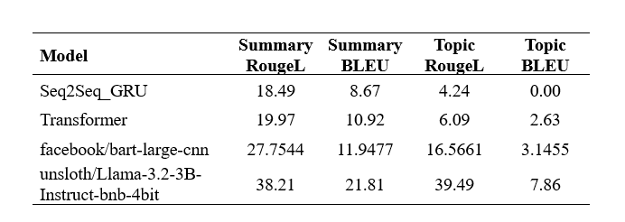

# DialogSum Multi-Task NLP: Dialogue Summarization & Topic Extraction

[](https://www.python.org/downloads/)
[](https://pytorch.org/)
[](https://fastapi.tiangolo.com)
[](https://streamlit.io)
[](https://huggingface.co/huynoob1312)

A comprehensive multi-task NLP system trained on the [`knkarthick/dialogsum`](https://huggingface.co/datasets/knkarthick/dialogsum) benchmark dataset. The system performs simultaneous **Dialogue Summarization** and **Topic Extraction** across four evolutionary deep learning architectures: from custom-built neural networks from scratch to modern instruction-tuned Large Language Models.

---

## Project Overview

This project investigates and compares architectural paradigms for multi-task conversational text generation:
1. **Custom Seq2Seq GRU** — Recurrent encoder-decoder built from scratch using PyTorch.
2. **Custom Seq2Seq Transformer** — Multi-head self-attention encoder-decoder with positional embeddings built from scratch.
3. **BART-Large-CNN** — Pretrained bidirectional and auto-regressive transformer (`facebook/bart-large-cnn`) fine-tuned for multi-task sequence generation.
4. **LLaMA-3.2-3B-Instruct** — SOTA causal LLM fine-tuned using parameter-efficient QLoRA via Unsloth.

The models are deployed through a clean production-ready architecture featuring a **FastAPI REST API** and an interactive **Streamlit Web UI**.

---

## Experimental Results & Benchmarks

The models were evaluated on the test set of **DialogSum** (1,500 unseen conversations) using **ROUGE-L** and **SacreBLEU** metrics for both summary and topic tasks.

<p align="center">
  
</p>

### Detailed Performance Comparison

| Model | Summary Rouge-L | Summary BLEU | Topic Rouge-L | Topic BLEU | Architecture Type |
| :--- | :---: | :---: | :---: | :---: | :--- |
| **Seq2Seq_GRU** | 18.49% | 8.67 | 4.24% | 0.00 | Custom Recurrent (Baseline) |
| **Seq2Seq_Transformer** | 19.97% | 10.92 | 6.09% | 2.63 | Custom Multi-Head Self-Attention |
| **facebook/bart-large-cnn** | 27.75% | 11.95 | 16.57% | 3.15 | Pretrained Encoder-Decoder (406M) |
| **LLaMA-3.2-3B-Instruct** | **38.21%** | **21.81** | **39.49%** | **7.86** | **Instruction-Tuned LLM + QLoRA** |

### Key Architectural Findings:
- **GRU Bottleneck:** Compressing entire dialogues into a single static hidden vector creates an information bottleneck. The short length of topic phrases (2–3 words) led to a zero BLEU-4 score due to geometric mean penalization.
- **Self-Attention Advantage:** The custom Transformer significantly improved dialogue understanding by modeling long-range token relationships via multi-head attention.
- **Pretraining Power:** BART leveraged vast pre-trained linguistic knowledge to produce fluent summaries, yielding a substantial leap in ROUGE-L (+7.78%).
- **LLM Dominance:** LLaMA-3.2-3B demonstrated superior reasoning and instruction-following capabilities, outperforming BART by **+10.46% Summary ROUGE-L**, nearly **doubling Summary BLEU**, and achieving **39.49% Topic ROUGE-L** (+22.92%).

---

## Project Structure

```text
DialogSum/
├── app/
│   ├── api/
│   │   └── routes.py              # FastAPI endpoint routing (/predict/gru, /predict/bart, etc.)
│   ├── models/
│   │   ├── gru.py                 # PyTorch Seq2Seq-GRU architecture definition
│   │   └── transformer.py         # PyTorch Seq2Seq-Transformer architecture definition
│   ├── schemas/
│   │   └── dialogue.py            # Pydantic request and response schemas
│   ├── services/
│   │   ├── gru_service.py         # GRU loading & autoregressive inference
│   │   ├── transformer_service.py # Transformer loading & inference
│   │   ├── bart_service.py        # BART model loading & text generation
│   │   └── llama_service.py       # LLaMA-3.2 inference service
│   └── config.py                  # Model repositories & global settings
├── assets/
│   └── benchmark.png              # Benchmark evaluation comparison image
├── frontend/
│   └── app.py                     # Streamlit web application
├── train/
│   ├── GRU_train.ipynb            # Training notebook for Seq2Seq GRU
│   ├── Transformer_train.ipynb    # Training notebook for Seq2Seq Transformer
│   ├── BART_train.ipynb           # Fine-tuning notebook for BART-Large
│   └── Llama3_Unsloth.ipynb       # QLoRA fine-tuning notebook for LLaMA-3.2
├── main.py                        # FastAPI application entrypoint
├── requirements.txt               # Project dependencies
└── README.md
```

---

## Getting Started

### 1. Clone the Repository
```bash
git clone https://github.com/your-username/DialogSum.git
cd DialogSum
```

### 2. Environment Setup
Create and activate a virtual environment:
```bash
conda create -n diosum python=3.10 -y
conda activate diosum
pip install -r requirements.txt
```

### 3. Running the FastAPI Backend
Start the REST API server:
```bash
python main.py
```
- API Documentation (Swagger UI): `http://127.0.0.1:8000/docs`
- Alternative Redoc: `http://127.0.0.1:8000/redoc`

### 4. Running the Streamlit Web Application
Launch the interactive web UI:
```bash
streamlit run frontend/app.py
```
Open your browser at `http://localhost:8501` to test with preset conversation samples or enter custom dialogue.

---

## API Usage Example

Send a `POST` request to test any model:

```bash
curl -X POST "http://127.0.0.1:8000/api/v1/predict/bart" \
  -H "Content-Type: application/json" \
  -d '{
    "dialogue": "#Person1#: Hi Brian, are you free this evening?\n#Person2#: Yes, let us have dinner together at the Italian bistro.",
    "max_summary_len": 64,
    "max_topic_len": 25
  }'
```

**Response:**
```json
{
  "model_name": "BART",
  "topic": "dinner invitation",
  "summary": "Brian and #Person1# plan to have dinner together at the Italian bistro tonight.",
  "execution_time_ms": 320.45
}
```

---

## Model Checkpoints on Hugging Face Hub

Pretrained model weights and LoRA adapters are hosted on Hugging Face:
- **Seq2Seq-GRU:** [`huynoob1312/dialogsum-multi-task-gru`](https://huggingface.co/huynoob1312/dialogsum-multi-task-gru)
- **Seq2Seq-Transformer:** [`huynoob1312/dialogsum-multi-task-transformer`](https://huggingface.co/huynoob1312/dialogsum-multi-task-transformer)
- **BART-Large-CNN:** [`huynoob1312/dialogsum-multi-task-BART`](https://huggingface.co/huynoob1312/dialogsum-multi-task-BART)
- **LLaMA-3.2-3B:** [`huynoob1312/dialogsum-llama-3.2-3b`](https://huggingface.co/huynoob1312/dialogsum-llama-3.2-3b)

---

## License
This project is licensed under the MIT License.
